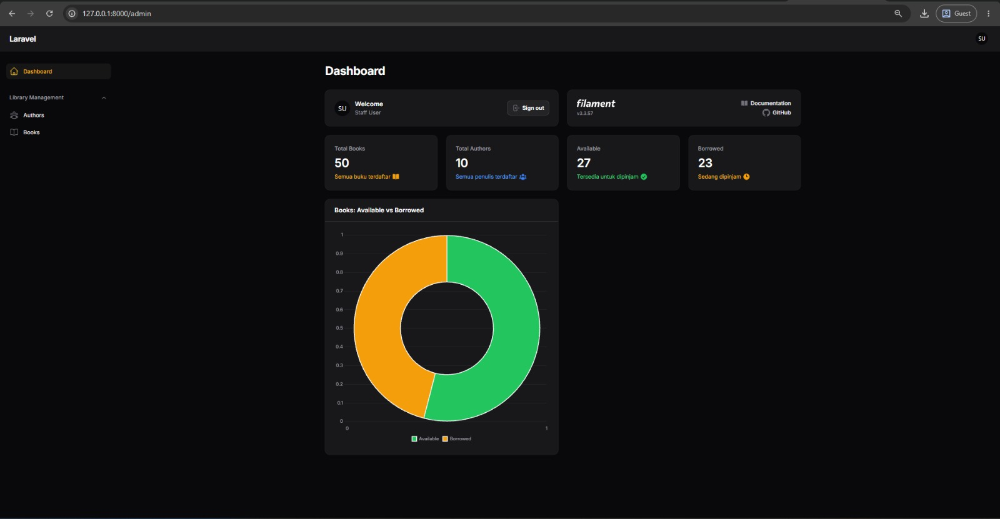
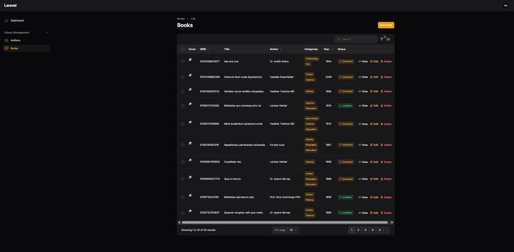
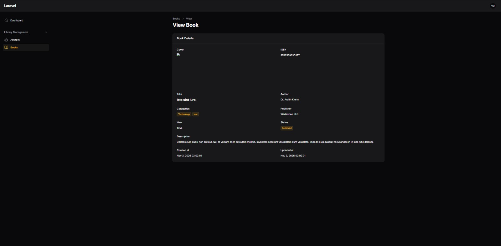
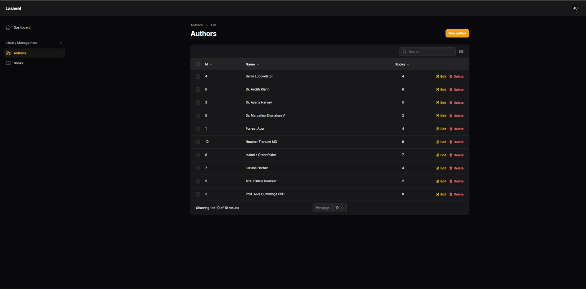
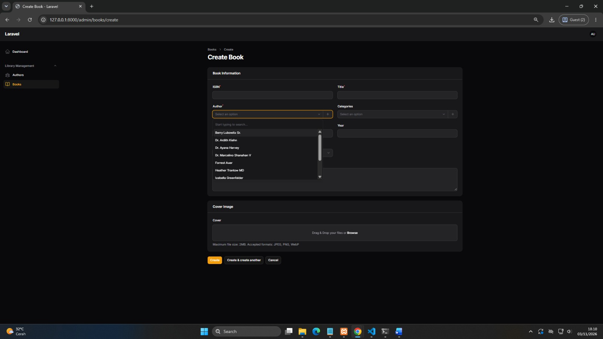
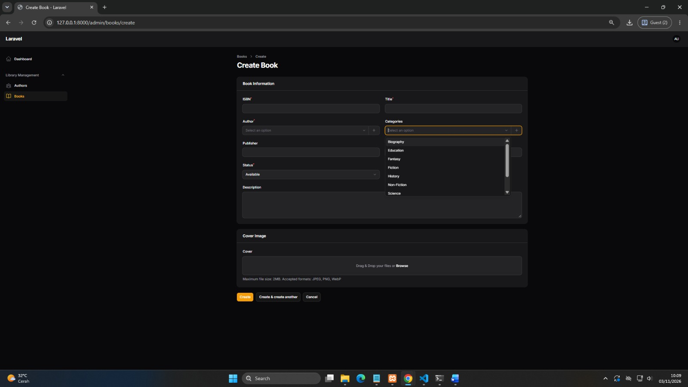

# 📘 Laporan Praktikum Pertemuan Ke-7

🧑‍🎓 **Reevan Azepha Islamy Iskandar — 4524210083**

# 📚 AuthBook — Sistem Manajemen Perpustakaan

AuthBook merupakan aplikasi website berbasis Laravel yang dikembangkan untuk memenuhi tugas Praktikum 7 mata kuliah Pemrograman Berbasis Web (PBW). Aplikasi ini digunakan untuk mengelola data buku, penulis, dan kategori buku melalui dashboard administrasi Filament.

Pada praktikum ini, aplikasi dikembangkan dengan menambahkan deskripsi buku, sistem hak akses pengguna berdasarkan role, pengelolaan kategori, serta dashboard yang menampilkan statistik dan grafik status buku.

Aplikasi menggunakan database SQLite untuk menyimpan seluruh data yang diperlukan.

<p align="center">
  
  
  
  
  
</p>

## 📋 Daftar Isi

- [Tentang Aplikasi](#-tentang-aplikasi)
- [Fitur Utama](#-fitur-utama)
- [Sistem Hak Akses](#-sistem-hak-akses)
- [Tech Stack](#-tech-stack)
- [Persyaratan Sistem](#-persyaratan-sistem)
- [Instalasi](#-instalasi)
- [Konfigurasi Database](#-konfigurasi-database)
- [Penggunaan Aplikasi](#-penggunaan-aplikasi)
- [Struktur Database](#-struktur-database)
- [Struktur Project](#-struktur-project)
- [Testing](#-testing)
- [Penutup](#-penutup)

## 🎯 Tentang Aplikasi

AuthBook adalah aplikasi manajemen perpustakaan sederhana yang dibangun menggunakan Laravel 12 dan Filament 3.

Aplikasi ini menyediakan dashboard administrasi untuk mengelola informasi buku, penulis, dan kategori. Selain itu, terdapat sistem role pengguna yang membedakan hak akses Admin, Staff, dan Viewer.

Pengembangan Praktikum 7 berfokus pada penambahan fitur deskripsi buku, manajemen kategori, pengaturan hak akses, serta penyajian informasi statistik melalui dashboard.

### Modul Aplikasi

1. **Dashboard Admin** — Menampilkan informasi statistik perpustakaan.
2. **Manajemen Buku** — Mengelola informasi dan status buku.
3. **Manajemen Penulis** — Mengelola data penulis buku.
4. **Manajemen Kategori** — Mengelompokkan buku berdasarkan kategori.
5. **Manajemen Pengguna** — Mengatur role dan hak akses pengguna.
6. **Statistik Perpustakaan** — Menampilkan jumlah buku, penulis, dan status ketersediaan buku.

## ✨ Fitur Utama

- 📚 **Manajemen Buku** — Menambahkan, melihat, mengubah, dan menghapus data buku.
- 📝 **Deskripsi Buku** — Menambahkan informasi atau penjelasan mengenai buku.
- ✍️ **Manajemen Penulis** — Mengelola data penulis dan hubungannya dengan buku.
- 🏷️ **Manajemen Kategori** — Menambahkan, mengubah, dan menghapus kategori buku.
- 🔗 **Relasi Buku dan Kategori** — Satu buku dapat memiliki lebih dari satu kategori.
- 🖼️ **Upload Sampul Buku** — Mengunggah gambar sampul buku dengan format JPEG, PNG, dan WebP.
- 🔐 **Role Management** — Membagi pengguna menjadi Admin, Staff, dan Viewer.
- 🛡️ **Authorization Policy** — Mengatur izin pengguna berdasarkan role.
- 📊 **Dashboard Statistik** — Menampilkan jumlah seluruh buku, penulis, buku tersedia, dan buku yang dipinjam.
- 📈 **Grafik Status Buku** — Menampilkan perbandingan buku Available dan Borrowed.
- 🗄️ **Database SQLite** — Menyimpan data aplikasi menggunakan database SQLite.

## 🔐 Sistem Hak Akses Pengguna

AuthBook memiliki tiga jenis role pengguna dengan hak akses yang berbeda.

| Role | Melihat Data | Tambah Data | Edit Data | Hapus Data |
|---|---|---|---|---|
| Admin | ✓ | ✓ | ✓ | ✓ |
| Staff | ✓ | ✓ | ✓ | ✗ |
| Viewer | ✓ | ✗ | ✗ | ✗ |

### Penjelasan Role

**1. Admin**

Admin memiliki hak akses penuh terhadap aplikasi. Admin dapat melihat, menambahkan, mengubah, dan menghapus data buku, penulis, maupun kategori.

**2. Staff**

Staff dapat melihat, menambahkan, dan mengubah data buku serta kategori. Namun, Staff tidak memiliki izin untuk menghapus data.

**3. Viewer**

Viewer hanya memiliki hak untuk melihat data yang tersedia tanpa dapat menambahkan, mengubah, maupun menghapus data.

Pengaturan hak akses diterapkan menggunakan Laravel Policy.

## 🛠️ Tech Stack

### Backend

- **Laravel 12.x** — Framework pengembangan aplikasi web.
- **PHP 8.2+** — Bahasa pemrograman backend.
- **Eloquent ORM** — Mengelola data dan relasi antarmodel.
- **Laravel Policy** — Mengatur hak akses pengguna.

### Admin Panel

- **Filament 3.x** — Framework untuk membangun dashboard administrasi.
- **Filament Resource** — Mengelola data buku, penulis, dan kategori.
- **Filament Widgets** — Menampilkan statistik dan grafik pada dashboard.

### Frontend

- **Blade Template** — Template engine Laravel.
- **Tailwind CSS 4.0** — Framework CSS.
- **Vite 7** — Pengelolaan dan build aset frontend.
- **JavaScript** — Mendukung kebutuhan interaksi frontend.

### Database

- **SQLite** — Database relasional untuk menyimpan data aplikasi.
- **Laravel Migration** — Mengelola struktur tabel database.
- **Database Seeder** — Mengisi data awal aplikasi.

### Development Tools

- **Composer** — Pengelola dependensi PHP.
- **Node.js dan npm** — Pengelola dependensi frontend.
- **PHP Artisan** — Menjalankan perintah Laravel.
- **PHPUnit** — Framework pengujian aplikasi.

## 💻 Persyaratan Sistem

Sebelum menjalankan aplikasi, pastikan perangkat telah memiliki:

- PHP versi 8.2 atau lebih baru.
- Composer.
- Node.js dan npm.
- Git untuk melakukan clone repository.
- Ekstensi PHP yang dibutuhkan Laravel dan Filament, termasuk `intl`.

## 🚀 Instalasi

### 1. Clone Repository

Jalankan perintah berikut melalui terminal:

```bash
git clone https://github.com/ReevanAzep/4524210083-ReevanAzephaIslamyIskandar-PBW-A-Praktikum7.git
```

Masuk ke direktori proyek:

```bash
cd 4524210083-ReevanAzephaIslamyIskandar-PBW-A-Praktikum7
```

Masuk ke folder aplikasi Laravel:

```bash
cd authbook-tugas2_testing
```

### 2. Install Dependencies

Install dependensi PHP:

```bash
composer install
```

Install dependensi frontend:

```bash
npm install
```

### 3. Setup Environment

Salin file `.env.example` menjadi `.env`.

Untuk Git Bash:

```bash
cp .env.example .env
```

Untuk Windows Command Prompt:

```cmd
copy .env.example .env
```

Generate application key:

```bash
php artisan key:generate
```

### 4. Konfigurasi Database SQLite

Buka file `.env` dan pastikan konfigurasi database menggunakan SQLite:

```env
DB_CONNECTION=sqlite
```

Pastikan file database tersedia pada lokasi:

```text
database/database.sqlite
```

Jika file belum tersedia, buat file kosong dengan nama `database.sqlite` di dalam folder `database`.

### 5. Jalankan Migration

Jalankan perintah berikut untuk membuat tabel database:

```bash
php artisan migrate
```

Migration akan membuat tabel yang diperlukan, termasuk:

- users
- authors
- books
- categories
- book_category
- cache
- jobs

### 6. Jalankan Database Seeder

Untuk memasukkan data awal pengguna dan kategori, jalankan:

```bash
php artisan db:seed
```

Seeder akan membuat tiga akun pengguna dengan role berbeda serta beberapa kategori buku.

### 7. Hubungkan Storage

Untuk menampilkan gambar sampul buku yang diunggah, jalankan:

```bash
php artisan storage:link
```

### 8. Build Assets

Untuk menjalankan frontend dalam mode pengembangan:

```bash
npm run dev
```

Untuk membangun aset versi produksi:

```bash
npm run build
```

### 9. Jalankan Aplikasi

Jalankan server Laravel:

```bash
php artisan serve
```

Buka browser dan akses:

http://127.0.0.1:8000/admin

## 👤 Akun Pengguna

Setelah menjalankan database seeder, tersedia tiga akun contoh berikut:

| Role | Email | Password |
|---|---|---|
| Admin | admin@example.com | password |
| Staff | staff@example.com | password |
| Viewer | viewer@example.com | password |

<text color="secondary" size="xs">Catatan: Akun tersebut merupakan akun pengujian dari UserSeeder. Ganti password untuk penggunaan di luar lingkungan praktikum.</text>

## 🌐 Penggunaan Aplikasi

1. Jalankan aplikasi menggunakan perintah `php artisan serve`.
2. Buka halaman admin Filament melalui browser.
3. Login menggunakan salah satu akun yang tersedia.
4. Masuk ke dashboard untuk melihat statistik perpustakaan.
5. Pilih menu **Books** untuk mengelola data buku.
6. Pilih menu **Authors** untuk mengelola data penulis.
7. Pilih menu **Categories** untuk mengelola kategori buku.
8. Tambahkan atau ubah informasi buku, termasuk deskripsi, kategori, dan sampul buku.
9. Coba login menggunakan role yang berbeda untuk melihat perbedaan hak akses.

## 🗄️ Struktur Database

Aplikasi menggunakan SQLite dengan beberapa tabel utama sebagai berikut:

### 1. Tabel Users

Menyimpan informasi pengguna aplikasi.

| Kolom | Keterangan |
|---|---|
| id | ID pengguna |
| name | Nama pengguna |
| email | Email pengguna |
| role | Hak akses pengguna |
| password | Password pengguna |

### 2. Tabel Authors

Menyimpan informasi penulis buku.

| Kolom | Keterangan |
|---|---|
| id | ID penulis |
| name | Nama penulis |
| created_at | Waktu data dibuat |
| updated_at | Waktu data diperbarui |

### 3. Tabel Books

Menyimpan informasi buku.

| Kolom | Keterangan |
|---|---|
| id | ID buku |
| isbn | Nomor ISBN |
| title | Judul buku |
| author_id | ID penulis |
| publisher | Nama penerbit |
| description | Deskripsi buku |
| year | Tahun terbit |
| cover | Gambar sampul buku |
| status | Status ketersediaan buku |

### 4. Tabel Categories

Menyimpan kategori buku.

| Kolom | Keterangan |
|---|---|
| id | ID kategori |
| name | Nama kategori |
| created_at | Waktu data dibuat |
| updated_at | Waktu data diperbarui |

### 5. Tabel Book_Category

Merupakan tabel pivot yang menghubungkan buku dengan kategori.

| Kolom | Keterangan |
|---|---|
| id | ID relasi |
| book_id | ID buku |
| category_id | ID kategori |
| created_at | Waktu data dibuat |
| updated_at | Waktu data diperbarui |

### Relasi Database

- Satu penulis dapat memiliki banyak buku (One to Many).
- Satu buku memiliki satu penulis.
- Satu buku dapat memiliki banyak kategori (Many to Many).
- Satu kategori dapat digunakan oleh banyak buku.

## 📂 Struktur Project

Berikut struktur utama proyek AuthBook Praktikum 7:

```text
authbook-tugas2_testing/
├── app/
│   ├── Filament/
│   │   ├── Resources/
│   │   │   ├── AuthorResource.php
│   │   │   ├── BookResource.php
│   │   │   └── CategoryResource.php
│   │   └── Widgets/
│   │       ├── BookStatusChart.php
│   │       └── LibraryStatsOverview.php
│   ├── Http/
│   │   └── Controllers/
│   ├── Models/
│   │   ├── Author.php
│   │   ├── Book.php
│   │   ├── Category.php
│   │   └── User.php
│   ├── Policies/
│   │   ├── AuthorPolicy.php
│   │   ├── BookPolicy.php
│   │   └── CategoryPolicy.php
│   └── Providers/
├── bootstrap/
├── config/
├── database/
│   ├── factories/
│   ├── migrations/
│   ├── seeders/
│   │   ├── CategorySeeder.php
│   │   ├── UserSeeder.php
│   │   └── DatabaseSeeder.php
│   └── database.sqlite
├── public/
├── resources/
│   ├── css/
│   ├── js/
│   └── views/
├── routes/
│   └── web.php
├── tests/
├── .env.example
├── artisan
├── composer.json
├── composer.lock
└── package.json
```

### Keterangan Struktur

- `app/Models/` — Menyimpan model Author, Book, Category, dan User.
- `app/Filament/Resources/` — Mengatur formulir dan tabel pengelolaan data.
- `app/Filament/Widgets/` — Menampilkan statistik dan grafik dashboard.
- `app/Policies/` — Mengatur hak akses berdasarkan role pengguna.
- `database/migrations/` — Menyimpan struktur tabel database.
- `database/seeders/` — Menyediakan data awal pengguna dan kategori.
- `resources/` — Menyimpan aset frontend dan template aplikasi.
- `routes/` — Mengatur rute aplikasi Laravel.

## 🧪 Testing

Untuk menjalankan pengujian otomatis Laravel, gunakan perintah:

```bash
php artisan test
```

Beberapa aspek yang dapat diuji:

- Koneksi aplikasi dengan database SQLite.
- Penambahan dan pengubahan data buku.
- Penghapusan data buku berdasarkan hak akses.
- Pengelolaan data penulis.
- Pengelolaan kategori buku.
- Relasi antara buku, penulis, dan kategori.
- Penyimpanan deskripsi buku.
- Upload gambar sampul buku.
- Hak akses Admin, Staff, dan Viewer.
- Tampilan statistik dan grafik dashboard.

Pengujian dilakukan untuk memastikan setiap fitur dapat berjalan sesuai dengan hak akses dan kebutuhan aplikasi.

## Screenshot Website

### Screenshot Dashboard Panel


### Screenshot List Books


### Screenshot View Books


### Screenshot Authors


### Screenshot Form Create Book Authors


### Screenshot Form Create Book Categories


## 📄 Penutup

Melalui Praktikum 7, aplikasi AuthBook dikembangkan dengan menambahkan beberapa fitur untuk mendukung pengelolaan perpustakaan. Penambahan deskripsi buku, kategori, sistem role pengguna, serta dashboard statistik membuat pengelolaan data menjadi lebih terstruktur.

Praktikum ini juga memberikan pemahaman mengenai penggunaan Laravel Policy untuk mengatur hak akses dan Filament untuk membangun dashboard administrasi.

---

<p align="center">
  <b>Dibuat dengan ❤️ menggunakan Laravel dan Filament</b>
  <br>
  <i>Praktikum 7 — Pemrograman Berbasis Web</i>
</p>
